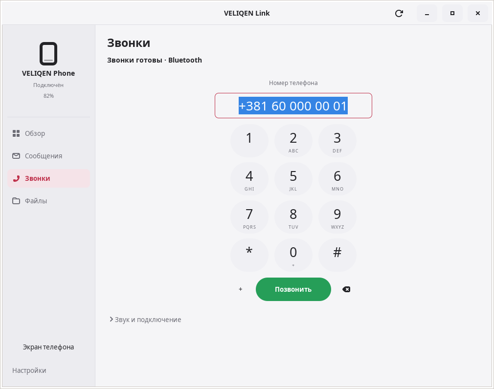

# VELIQEN Link

Connect an Ubuntu computer to a VELIQEN OS or Android phone. Use the computer for SMS, file transfers, clipboard text, phone screen access and cellular calls through the phone.

**[Русская инструкция](README_RU.md)** · Version **1.2.1**



## Install

Download these two files from the project's GitHub Release or the supplied release kit:

| Device | File |
| --- | --- |
| Ubuntu 26.04, Intel or AMD 64-bit | `veliqen-link_1.2.1_amd64.deb` |
| VELIQEN OS or Android | `VELIQEN-Link-1.2.1-Android.apk` |

### Ubuntu

Open a terminal in the folder containing the DEB:

```bash
sudo apt update
sudo apt install ./veliqen-link_1.2.1_amd64.deb
```

APT installs VELIQEN Link and resolves its declared system dependencies. Internet access and working Ubuntu repositories are required for dependencies that are not already installed. `dpkg -i` alone does not download dependencies.

The DEB includes the desktop application, launcher, GNOME clipboard extension, autostart entry and the official scrcpy 5.0.1 tools for the optional advanced screen mode. You do not need to run the full-kit installer for a normal installation. Open **VELIQEN Link** from the applications menu. Restart a running older window after upgrading.

For a failing regional Ubuntu mirror, the full release kit also includes an optional recovery installer:

```bash
bash INSTALL-UBUNTU.sh --ubuntu-main-mirror
```

It uses temporary official Ubuntu sources without rewriting `/etc/apt`. See [installation details](docs/INSTALLATION.md).

### Phone

Open the APK on the phone. If Android asks, allow installation from the app you used to open the file, then install VELIQEN Link.

The public application ID is **`tech.veliqen.link`**. The APK uses a dedicated release certificate. It can be installed alongside the earlier VELIQEN development builds and official KDE Connect, whose application ID is different. Pair the new app once and grant the features you want to use. Close or disable the old app to avoid duplicate notifications and connections. This installation does not migrate its private data or remove it automatically.

Future public updates must keep the same application ID and signing key. The public certificate is in [android/RELEASE-SIGNING.json](android/RELEASE-SIGNING.json). Private signing material is not part of this repository or the public release kit.

## Connect once

1. Put the phone and computer on the same local Wi-Fi network and open VELIQEN Link on both.
2. Choose the other device and confirm the pairing request on it. Check the displayed identity and code.
3. On the phone, open **Access** and grant only the features you want.
4. For cellular calls, also pair the phone with Ubuntu over Bluetooth and allow call audio.

## Features

| Feature | What it does | Requirements |
| --- | --- | --- |
| Calls | Dial, answer and end a cellular call, use the computer's microphone and speakers, enter digits in voice menus | SIM and mobile service on the phone, Bluetooth HFP support, PipeWire telephony |
| SMS | Read supported conversations and send an SMS through the phone | SMS permission and working SMS on the phone |
| Files | Send files and links between devices | Local network and the file access requested by Android |
| Clipboard | Send copied text, optionally forward text automatically from Ubuntu | GNOME extension for automatic capture on Wayland, Android clipboard restrictions apply |
| Phone screen | Show the phone in a desktop window and optionally control it | Screen-sharing consent each session, Accessibility permission for control |
| Notifications and device status | See supported phone notifications and battery state, find the phone | Relevant phone permissions |

Local Wi-Fi carries data and the native screen stream. Bluetooth HFP carries cellular call audio. Bluetooth is not a replacement for the local network for the native screen stream. No VELIQEN cloud account is required.

## Everyday interface

Ubuntu provides Overview, Messages, Calls and Files. The dial pad supports `0–9`, `*`, `#` and `+`, keyboard input and in-call DTMF. Incoming calls also appear above other pages. Desktop `tel:` and `sms:` actions fill in the destination and require a user action to call or send.

The phone opens to one computer card and four actions: Screen, Files, Clipboard and Calls. Feature permissions and settings are separate from the main screen.

## Compatibility and limits

- This release targets Ubuntu 26.04 on amd64, GNOME and PipeWire. The package enforces its required dependency versions. Other distributions and ARM computers are not validated targets for this binary.
- On GNOME Wayland, enable the included VELIQEN Clipboard extension from the application. A logout and login may be needed before a newly installed extension is available to the session.
- Android restricts clipboard reads in the background. A regular APK provides manual transfer and permitted foreground behavior. Deeper clipboard integration requires the separately documented VELIQEN OS system build.
- Android always controls screen-sharing and Accessibility permissions. The app cannot bypass the lock screen or grant these permissions to itself.
- Call audio depends on the phone firmware, Bluetooth adapter and HFP support. Validate two-way audio and DTMF on the hardware you intend to support.
- The native screen mode sends JPEG frames and has no screen-audio channel. The advanced scrcpy mode has its own Android authorization flow.

See [validation scope](docs/VALIDATION.md), [calls](docs/CALLS_RU.md) and [native screen sharing](docs/NATIVE_SCREEN_RU.md).

## Build and contribute

```bash
python3 BUILD-PACKAGES.py
```

Android uses JDK 21, Android SDK 37 and Build Tools 37.0.0. The Gradle wrapper and pinned build versions are included. See [Android build instructions](android/README-RU.md).

```bash
bash android/BUILD-APK.sh --unsigned
```

Unsigned APKs are build artifacts and cannot be installed normally. Only the signed `VELIQEN-Link-1.2.1-Android.apk` is the public installation file.

The GitHub Actions workflow builds the DEB and an unsigned Android artifact. It does not receive signing secrets or publish releases. Local build results and checks are recorded in `RELEASE-CHECKS.json`; the workflow itself must run in the destination repository before a CI result can be claimed.

For publication, use [the GitHub guide](docs/GITHUB-RELEASE.md). Keep the corresponding source, third-party source bundle, notices and checksums with the binaries.

## Open-source components

VELIQEN's desktop code and original integration changes use GPL-3.0-or-later. The Android app adapts KDE Connect and retains its upstream copyright and license notices. The Ubuntu app uses the system KDE Connect service, PipeWire, WirePlumber, BlueZ and GTK. The optional advanced screen mode includes the official scrcpy distribution.

See [LICENSE](LICENSE), [THIRD_PARTY.md](THIRD_PARTY.md), `android/UPSTREAM.json` and `vendor/SOURCES.md`. VELIQEN Link is an independent project and does not imply endorsement by those upstream projects.
