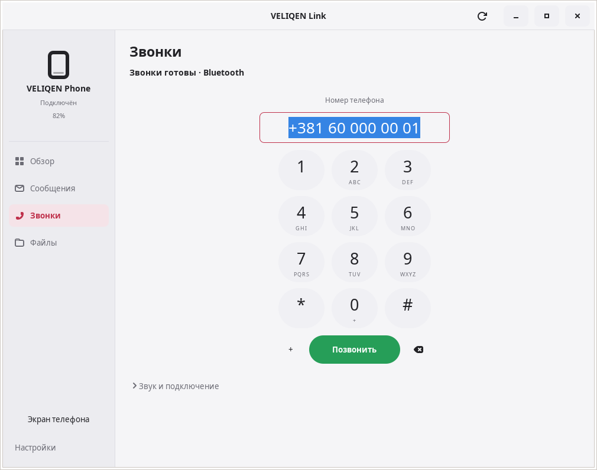

# VELIQEN Link 1.2.1

Телефон и Ubuntu: звонки, SMS, файлы, буфер обмена и экран телефона в одном приложении.

[English documentation](README.md)



## Установка

Скачай готовые установочные файлы. В полном комплекте они находятся в папке **Установочные-файлы**:

| Устройство | Файл |
| --- | --- |
| Ubuntu 26.04, компьютер Intel/AMD 64-bit | `veliqen-link_1.2.1_amd64.deb` |
| VELIQEN OS / Android | `VELIQEN-Link-1.2.1-Android.apk` |

### На Ubuntu

Открой терминал в папке, куда скачан DEB, и выполни:

```bash
sudo apt update
sudo apt install ./veliqen-link_1.2.1_amd64.deb
```

APT установит приложение и скачает недостающие системные зависимости. Для этого нужны интернет и доступные репозитории Ubuntu. В DEB уже включены интерфейс, значок и меню приложения, автозапуск, расширение GNOME для буфера, scrcpy 5.0.1 для дополнительного режима экрана. Отдельные установочные скрипты для обычной установки не нужны.

После установки открой **VELIQEN Link** из меню приложений. После обновления закрой старое окно и запусти приложение снова. Пакет сохраняет пользовательские настройки и сопряжения Ubuntu. Для автоматического буфера GNOME может понадобиться повторный вход в сеанс; включение расширения доступно в настройках приложения.

Если региональное зеркало Ubuntu недоступно, в полном комплекте есть дополнительный установщик. Запусти из распакованной папки:

```bash
bash INSTALL-UBUNTU.sh --ubuntu-main-mirror
```

Он временно использует официальные HTTPS-серверы Ubuntu. Постоянные файлы `/etc/apt` не меняются. Сначала скачиваются зависимости, затем закрывается прежнее окно текущего пользователя и устанавливается обновление. Исправление ошибки APT `Pathname to install is not absolute` сохранено.

### На телефоне

Открой **VELIQEN-Link-1.2.1-Android.apk** и подтверди установку. Если Android попросит, разреши установку для приложения, через которое открыт файл.

Версия 1.2.1 устанавливается рядом с прежней тестовой версией и официальным KDE Connect. В новом приложении один раз подтверди сопряжение и выдай нужные разрешения. После перехода закрой или отключи прежнюю версию, чтобы не получать дубли уведомлений. Её настройки и данные автоматически не переносятся.

Подробности установки и удаления: [docs/INSTALLATION.md](docs/INSTALLATION.md).

## Интерфейс

На Ubuntu четыре основных раздела: **Обзор, Сообщения, Звонки, Файлы**. Имя телефона, состояние и заряд находятся в боковой панели. Экран открывается отдельным действием. На телефоне один главный экран с компьютером и действиями **Экран, Файлы, Буфер, Звонки**.

Номеронабиратель поддерживает **0–9, `*`, `#`, `+`**, удаление, ввод с клавиатуры и цифры для голосового меню текущего вызова. Во время разговора Enter не начинает второй звонок. Входящий вызов виден и над другими разделами.

На клавиатуре **Ctrl+1…4** переключает разделы, **Ctrl+Enter** отправляет SMS. Ссылки `tel:` и `sms:` заполняют номер или текст, затем пользователь подтверждает звонок либо отправку. Черновик не заменяется без подтверждения. Тема по умолчанию соответствует системе, также доступны светлая и тёмная.

## Подключить телефон один раз

Открой VELIQEN Link на обоих устройствах и подключи их к одной сети Wi-Fi. На телефоне разреши доступ к локальной сети, если Android его запросит, затем выбери найденный компьютер. Можно начать и с Ubuntu кнопкой **Подключить телефон**. Проверь имя и код и подтверди сопряжение на втором устройстве.

На телефоне открой строку настройки доступов и выбери нужные возможности. Приложение показывает фактическую готовность разрешений. Доступ к уведомлениям других приложений, работе в фоне и управлению экраном Android выдаёт на отдельных системных экранах.

После подключения Ubuntu показывает четыре быстрых действия:

| Действие | Результат |
| --- | --- |
| Экран | Запрос показа экрана телефона |
| Файл | Выбор файлов для отправки |
| Буфер | Передача скопированного текста на телефон |
| Найти | Звуковой сигнал на телефоне |

SMS и номеронабиратель доступны в боковом меню. Имя телефона, состояние связи и заряд находятся в боковой панели. Нажми на телефон для выбора устройства; при нескольких сопряжениях также появляется список. Смена телефона не должна подставлять чужую Bluetooth-привязку.

## Звонки

Открой **Звонки → Подключить звонки**. На телефоне открой действие **Звонки** и штатные настройки Bluetooth, сделай его видимым при необходимости. Выбери свой телефон на Ubuntu, сравни код и подтверди сопряжение. Если Android спрашивает о звонках для компьютера, разреши их.

Когда появится **Звонки готовы · Bluetooth**, набери номер кнопками или с клавиатуры и нажми **Позвонить** либо Enter. `+` вынесен отдельной кнопкой. Во время активного разговора тот же номеронабиратель служит для голосового меню: нажимай цифры, `*` и `#`. Отправленные в меню цифры нельзя отменить кнопкой стирания; она убирает только отображение. При завершении возвращается прежний черновик номера.

Входящий вызов виден в системном уведомлении и в компактной строке над другими разделами приложения. Его можно принять или отклонить, не уходя из переписки. В разделе «Звонки» управление отображается рядом с текущим вызовом.

Настройки звука находятся под **Звук и подключение**. После начала разговора приложение подключает выбранные микрофон и динамики, если включено автоподключение и выбор устройств однозначен. При нескольких устройствах выбери их один раз. Если предлагается **Настроить звонки на компьютере**, выполняй это после окончания разговора: перезапуск звуковой службы временно прервёт звук.

Сотовая связь и Bluetooth должны работать в самой VELIQEN OS. Звонок использует SIM телефона и Bluetooth HFP. Работа конкретного адаптера, двусторонняя слышимость и DTMF требуют проверки на устройствах. Диагностика, требования и откат настройки — в `docs/CALLS_RU.md`.

## Сообщения, файлы и буфер

**Сообщения.** Открой раздел — список загружается автоматически. Поиск фильтрует загруженные номера и превью. Выбери диалог или нажми **Новое SMS**. Справа находятся получатель, переписка и поле текста. Для отправки нажми кнопку либо Ctrl+Enter; обычный Enter переносит строку. Кнопка телефона рядом с получателем только открывает номеронабиратель. По умолчанию используется SIM телефона; идентификатор другой SIM — в **Параметры SMS**. При неопределённом результате отправка автоматически не повторяется.

**Файлы.** Используй действие **Файл** или перетащи файлы в раздел **Файлы**. Папку сначала упакуй в ZIP. В этом же разделе можно открыть загрузки и передать веб-ссылку на телефон. Ход передачи отображается системными уведомлениями. На телефоне выбирай файлы штатным системным диалогом.

**Буфер.** Кнопка **Буфер** передаёт уже скопированный текст. Дополнительная автопередача с Ubuntu включается в настройках. На GNOME/Wayland для неё нужно расширение VELIQEN Clipboard из комплекта; после первой установки может потребоваться повторный вход в сеанс.

У KDE Connect есть собственная настройка автоматического буфера. Переключатель VELIQEN не отключает её. Для полного отключения проверь также **Настройки → Подключение и диагностика → Параметры службы связи** и параметры телефона.

Android ограничивает чтение буфера в фоне: в обычном приложении пользуйся кнопкой **Буфер**. Автоматическая передача из фона требует системной интеграции в VELIQEN OS. Значения, отмеченные Android как чувствительные, по умолчанию пропускаются. Универсального распознавания всех паролей и кодов нет.

## Экран телефона

На Ubuntu нажми **Экран** в обзоре либо **Экран телефона** внизу боковой панели. На телефоне открой уведомление VELIQEN Link, нажми **Показать экран** и подтверди системный запрос. Начать можно и действием **Экран** в самом приложении телефона. Отдельное окно Ubuntu откроется после подтверждения.

Для управления мышью перед началом сеанса отметь **Разрешить управление в этом сеансе**, включи запрошенный доступ **VELIQEN: управление экраном** и вернись в приложение. Для простого просмотра этот доступ не требуется.

Android требует подтверждения каждого нового показа. При блокировке телефона, потере связи, отмене доверия и завершении показа сеанс прекращается. Обычный режим не требует ADB, режима разработчика, IP-адреса или отдельного кода. Изображение передаётся до 8 кадров в секунду; звук видео не передаётся. USB и scrcpy сохранены в свёрнутом дополнительном разделе.

Если файлы передаются, а экран не открывается, используй **Экран телефона → Экран не появился? → Разрешить подключение экрана**. При активном UFW добавится правило только для адреса выбранного телефона; Ubuntu запросит пароль. Сам firewall не отключается. Подробности — в `docs/NATIVE_SCREEN_RU.md`.

## Быстрые действия Ubuntu

- Правый клик по значку приложения в совместимом меню Ubuntu: **Звонки**, **Сообщения**, **Экран телефона**, **Передать файлы**.
- Индикатор приложения, если он поддерживается рабочим столом: звонки, сообщения, выбор файла и экран.
- Ctrl+1 — Обзор, Ctrl+2 — Сообщения, Ctrl+3 — Звонки, Ctrl+4 — Файлы.
- Ссылки `tel:` и `sms:` могут открываться в VELIQEN Link после выбора приложения обработчиком в системе. Установщик не меняет существующие приложения по умолчанию. Ссылки заполняют форму; звонок и отправка требуют явного действия.
- Для собственных ярлыков: `veliqen-link --page calls`, `--page messages`, `--page files`, `--page screen`. Действие передаётся уже открытому экземпляру приложения.

## Открытый код и совместимость

Основная целевая система: Ubuntu 26.04 amd64 с GNOME и PipeWire. Этот DEB не предназначен для ARM. Возможности звонков зависят от Bluetooth-адаптера и прошивки телефона. Bluetooth не заменяет Wi-Fi для нативного показа экрана.

Исходный код VELIQEN и его оригинальные дополнения распространяются под GPL-3.0-or-later. Android-часть основана на KDE Connect с сохранением исходных лицензий. На Ubuntu используются системные KDE Connect, PipeWire, WirePlumber, BlueZ и GTK. Для дополнительного режима экрана включён официальный scrcpy 5.0.1.

См. [LICENSE](LICENSE), [THIRD_PARTY.md](THIRD_PARTY.md), [docs/VALIDATION.md](docs/VALIDATION.md) и `RELEASE-CHECKS.json`. VELIQEN Link — самостоятельный проект, упоминание компонентов не означает одобрение со стороны их разработчиков.

## Удаление

Заверши приложение в настройках, затем:

```bash
sudo apt remove veliqen-link
```

Пользовательские сопряжения и настройки автоматически не удаляются. Откат отдельно включённой настройки звонков — в `docs/CALLS_RU.md`. Прежняя пользовательская копия расширения GNOME может оставаться в домашней папке.
